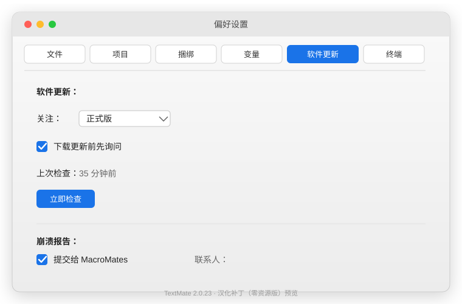

# TextMate 汉化补丁（零资源版）


把 **TextMate 2.0.23 (build 9800)** 的菜单、对话框、偏好设置面板（含那 6 个一直翻不掉的面板标题）汉化成中文。

**零资源**是这版的核心：仓库里**不含任何 TextMate 的二进制或资源文件**，所有中文都是在你**自己电脑上已安装的 TextMate** 运行时生成的。你拿到的是「译文表 + 脚本」，不是打包好的成品。



---

## 特性

- ✅ 菜单栏、对话框、按钮全中文（294 条译文）
- ✅ 偏好设置 **6 个面板标题**全中文：文件 / 项目 / 捆绑 / 变量 / 软件更新 / 终端
- ✅ 面板内部正文（关注、正式版、下载更新前先询问、提交给 MacroMates……）一并汉化
- ✅ 13 个 nib 现场从官方英文源生成，不打包任何成品资源
- ✅ 完整安全链：版本门禁 → 备份 → 命中率兜底 → 字节数校验 → 重签 → 启动验证 + 自动回滚

## 支持版本

| 项目 | 值 |
|---|---|
| 应用 | TextMate |
| 版本 | **2.0.23** |
| 构建号 | **9800** |

版本不匹配时脚本会**自动中止且不改动程序**（未命中 / 跳过超过阈值即停），所以装错版本也不会改坏东西。其他 2.x 版本理论上可用，但需要按文末「适配新版本」重新抽一遍译文表。

---

## 快速开始

### 方式一：双击（推荐）

1. 把整个文件夹拷到本机（U 盘 / 隔空投送 / 下载都行）
2. 若双击 `.command` 提示「无法验证开发者」→ 右键 → 打开 → 再点「打开」
3. 双击 **`汉化 TextMate.command`**，按提示走完（约 10 秒）

装完打开 TextMate，`⌘,` 偏好设置应该都是中文了。

### 方式二：命令行

```bash
./install.sh                       # 交互式
./install.sh --yes                 # 静默（同 .command）
./install.sh --app /Applications/TextMate.app   # 指定路径
```

> 不需要联网，不需要管理员密码（除非 TextMate 装在需要提权的位置）。

## 还原 / 查看状态

| 想做的事 | 怎么做 |
|---|---|
| 还原官方英文版 | 双击 **`还原官方英文版.command`**，或 `./uninstall.sh` |
| 查看当前汉化状态 | 双击 **`查看汉化状态.command`**，或 `./check.py` |

---

## 它是怎么工作的

| 层 | 改法 | 源码 |
|---|---|---|
| 菜单栏 / 对话框 / 偏好设置正文 / 面板标题 | 改二进制 `CFString` 表（原位替换 + 必要时空洞装箱） | `tools/zh_menu.py`、`tools/zh_pref.py` |
| 13 个 nib（MainMenu、各偏好面板等） | 用译文表套在你已装的官方英文 nib 上现场生成 | `tools/zh_nib.py` + `tools/nib_patch.py` |
| 4 个面板图标（项目 / 变量 / 软件更新 / 终端） | 从 `Projects.png` 等复制重命名 | `install.sh` |

全程：版本门禁 → 备份 → 打补丁 → **命中率兜底** → **字节数必须与原版一致** → ad-hoc 重签 → **启动 8 秒验证，崩了自动回滚** → 回读校验。

---

## 法律与许可证

- 本仓库以 **GPL-3.0** 发布（见 `LICENSE`）。
- TextMate 本身是 GPL 软件，本补丁只修改**你自己的副本**，不重新分发 TextMate 的任何部分。
- 仓库内容均为原创脚本与译文表（`tools/` 下的 `.py`），**不含** TextMate 的 nib 结构、HTML 文档或二进制。
- 关于窗口（About）与帮助文档（Help）的中文翻译**未包含**在本公开仓库，仅作为本地可选增强——它们属于 TextMate 的文档内容，为避免再分发争议这里留白。

---

## 适配新版本

译文按精确字符串匹配，换版本后大概率要重抽。步骤：

1. 在已汉化好的机器上，`extract_nib_tables.py` 会从当前已装 App 的 `English.lproj` 与 `zh-Hans.lproj` 抽 nib 对照表写进 `tools/zh_nib.py`。
2. 二进制菜单 / 偏好译文在 `tools/zh_menu.py`、`tools/zh_pref.py`，按新版的 `strings` 对照调整。
3. `./install.sh` 会报告未命中 / 跳过数，据此判断匹配度。

---

## 已知坑

- **偏好设置面板记忆键**：TextMate 把「上次选中的面板」存在 `defaults` 里。面板标题翻成中文后，旧键（英文）匹配不上，窗口会塌成 1×80 打不开。安装脚本已自动 `defaults delete` 这一项，装完直接能用。
- **面板标题是硬编码的面板 identifier**，不能直接当普通字符串翻——本补丁已处理（翻标题 + 同步补中文名图标）。
